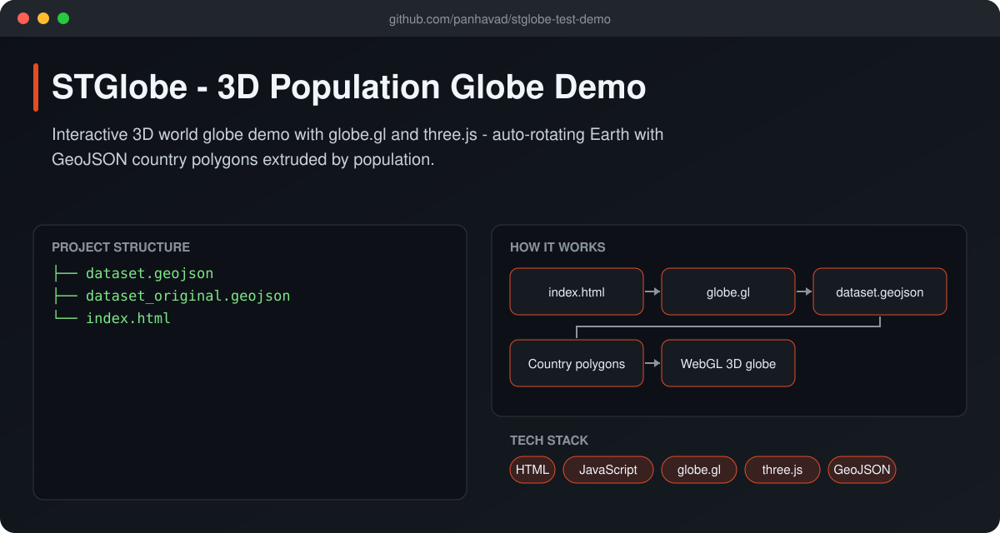
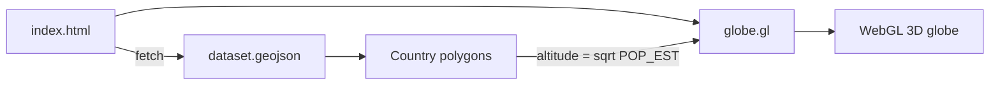

# STGlobe - 3D Population Globe Demo

  [](https://github.com/panhavad/stglobe-test-demo/releases/latest)

A single-page **3D globe data-visualization demo** built with [globe.gl](https://github.com/vasturiano/globe.gl) (three.js / WebGL). Countries from a GeoJSON file are drawn on a night-Earth texture and extruded by their estimated population while the globe slowly rotates.



## Features

- WebGL 3D globe with night-Earth texture
- Country polygons from `dataset.geojson`
- Extrusion height based on population (`POP_EST`)
- Hover labels with country name and ISO code
- Auto-rotation and smooth transitions

## How it works



## Getting started

```bash
# any static server works
python -m http.server 8000
# open http://localhost:8000
```

## Download

Grab the packaged source from the [latest release](https://github.com/panhavad/stglobe-test-demo/releases/latest).

## Tech stack

- HTML
- JavaScript
- globe.gl
- three.js
- GeoJSON

## Project structure

```text
stglobe-test-demo/
├── docs/
├── dataset.geojson
├── dataset_original.geojson
├── index.html
└── README.md
```
